# The Screen

`/materials` (or the Nexus Terminal) opens one screen. A rail on the left switches views, the top
bar says where you are, the bottom bar holds what is not applied yet.

## The frame

- **Top bar**: the path to where you are (*Material Nexus › Materials › Copper*) and the search
  box, which finds a material by name from any view.
- **Left rail**: Overview, Materials (with the number of forms still to decide), Forms, and Scripts
  when your scripts already unify something. Under **Advanced**: Rule files and Presets. At the
  foot: Help (this wiki), Shortcuts, Settings. On a dedicated server the screen is read-only.
- **Bottom bar**: how many changes are not applied yet, by kind. **View** lists them, **Discard
  all** drops them, **Review and apply** opens the review. Nothing is written before Apply.

Side panels open on the right; **Esc** closes them, then the screen.

## What the marks mean

A colour never comes alone: each state has its shape.

| Mark | State |
|---|---|
| gold dot | **To decide**: several items, no choice yet |
| blue ring | **Not applied yet**: your choice, waiting for Review and apply |
| green tick | **Unified**: one item is kept |
| red cross | removed, disabled, or marked "not the same" |
| nothing | **No duplicate**: nothing to do |

## Overview

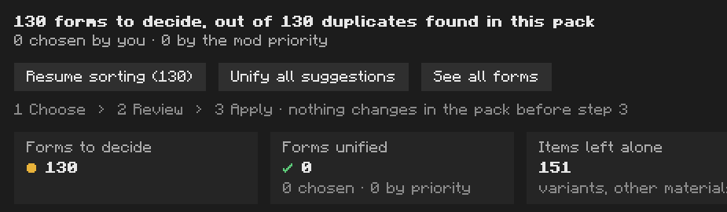

- One sentence on where the pack stands, and what to do next: **Start sorting** (see
  [Sort duplicates](#sort-duplicates)), **Unify all suggestions** (every suggestion becomes your
  choice, to review), **See all forms** (the grid of the Forms view).
- Three figures: forms to decide, forms unified (chosen by you / by the mod priority), items left
  alone. Each opens the material list filtered on it.
- **Mod priority**: ranked mods with **▲ ▼ ×**, other mods with **+**. See
  [Choosing Items](Choosing-Items#mod-priority).
- **History**: the last applies, reverts and restores. **Restore** on an older line puts the
  settings back as they were right after it.
- Apart from the rest, each behind a confirmation: **Revert last apply** and **Reset everything to
  default** (your choices and pack settings; the mod priority is kept).

Right after an apply, the Overview says what was applied, and to restart when items were created.

## Materials

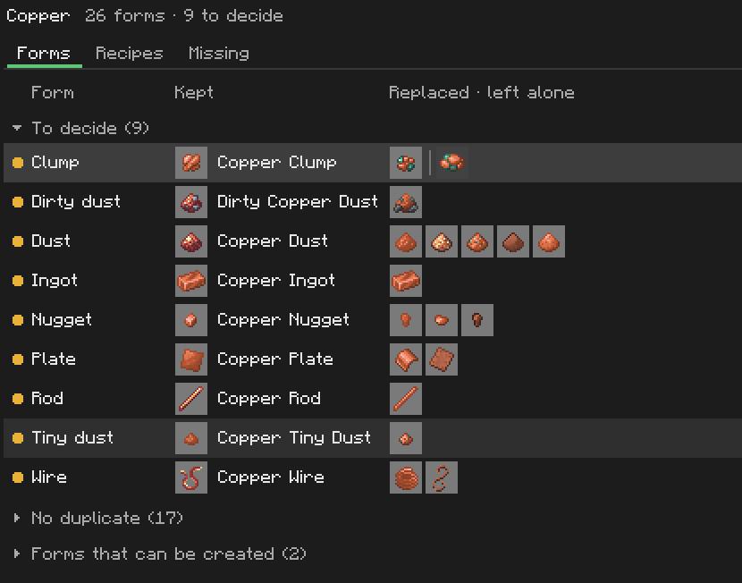

On the left, every material with the item that stands for it, filtered by **All / To decide /
Unified**; the number is how many of its forms are to decide. On the right, the selected material,
with three tabs.

### Forms

One row per form, in groups that fold: **To decide**, **Not applied yet**, **Unified**, then **No
duplicate** and **Forms that can be created**, folded by default. A row shows the kept item, then
the replaced ones and, greyed, the ones left alone.

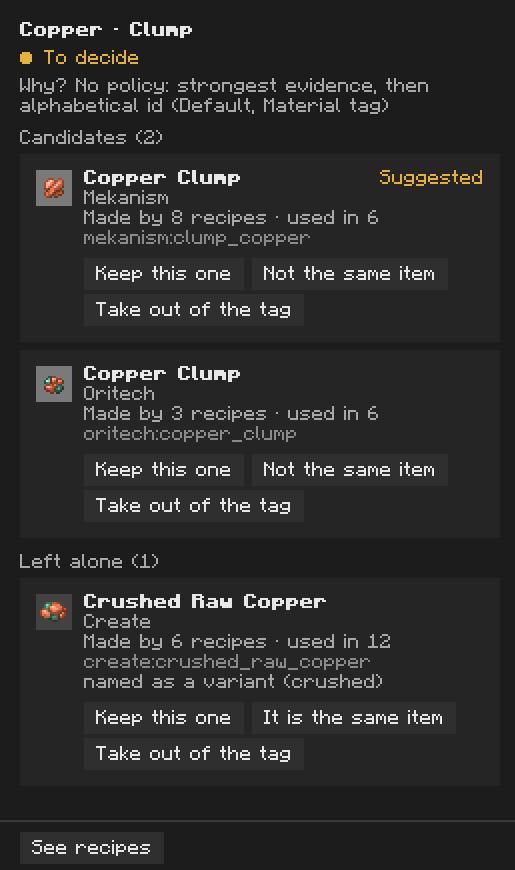

Select a row: the **inspector** on the right lists every item of that form as a card, with its
name, its mod, how many recipes make and use it, and why it is kept or left alone. Each card has
its actions as buttons:

- **Keep this one**: this item is kept for the form (not applied yet). **Cancel this choice** undoes it.
- **Not the same item**: never unified with the others.
- **It is the same item**: on an item left alone on a guess, makes it a candidate again
  ([Choosing Items](Choosing-Items#the-same-item-after-all)).
- **Take out of the tag**: removes it from this form's tag (`c:ingots/tin`) on Apply.

At the foot of the inspector: **See recipes**, and **Back to default** for a saved choice.

Faster, without the inspector: **click** an item in the table to keep it, **right click** for "not
the same", **Shift + right click** to take it out of the tag. A form the material lacks has **Create
item** when Material Nexus can create it ([Created Items](Created-Items)).

Header buttons: **Unify material** (accept the suggestions of this material), **× Discard (n)**,
**↺ Back to default (n)**.

### Recipes

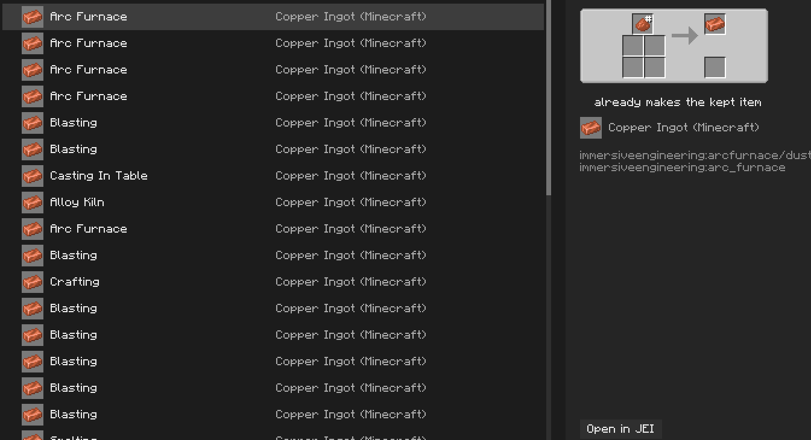

Every loaded recipe making the selected form, grouped by what applying does to it: **Rewritten**,
**Disabled**, **Not handled yet**, **Rewritten once applied**, **Already make the kept item**, **Make
a variant, left alone**.

The recipe itself is drawn by your recipe viewer, JEI or EMI: in the inspector for the selected
row, and next to the pointer when you hover another one. Machine names are the viewer's. For a
recipe whose result changes, the replaced item is struck through next to the kept one. **Open in
JEI / EMI** shows the item's recipes in the viewer. Without a viewer the list stays, without the
drawing. A disabled recipe is no longer loaded by the game: this list is the only place it appears.

### Missing

Standard conversions between this material's forms that no recipe provides (nugget to ingot, ingot
to block, dust to ingot...). These are proposals only; nothing is created from them. Use
[Process Rules](Process-Rules) to add recipes.

## Forms

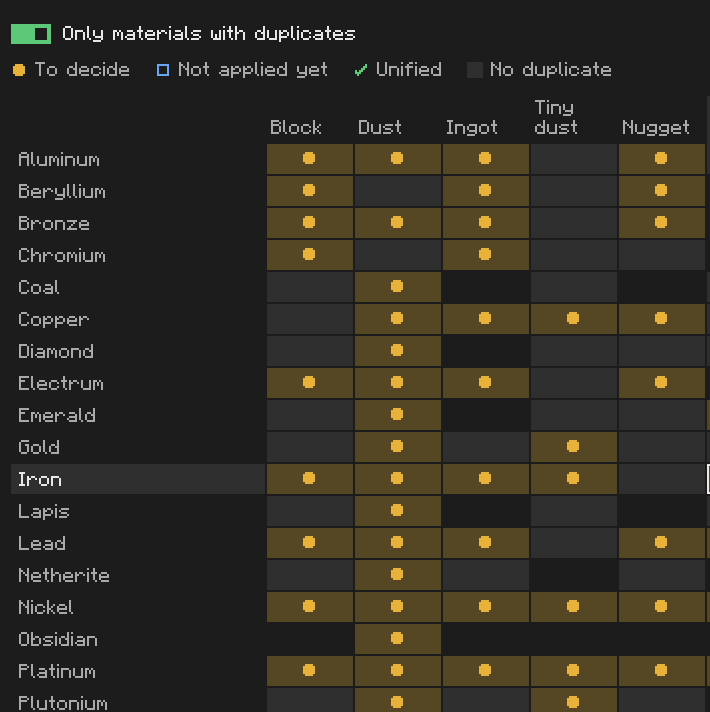

The whole pack as a grid: materials down, forms across, each cell with the mark of its state.
Materials without duplicates are left out by default. **Wheel** scrolls the materials, **Shift +
wheel** the forms. Click a material (or a cell) to open it; click a form's name to open the form.

A form has two tabs:

- **Forms**: the same table as a material, one row per material having that form.
- **How it's made**: how that form is made, for every material. See [Process Rules](Process-Rules).

## Sort duplicates

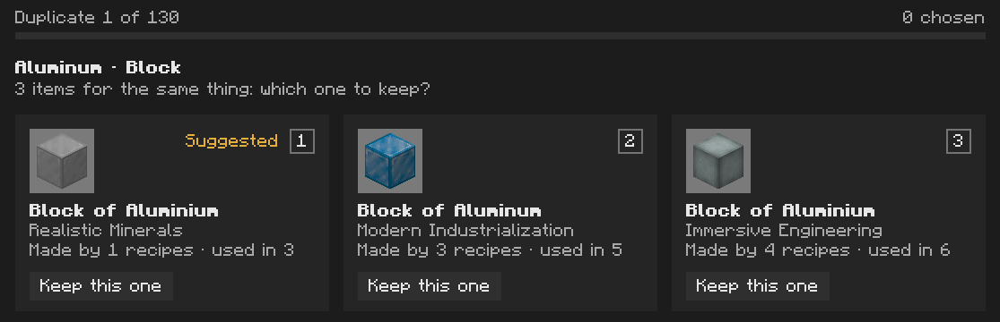

Every form to decide, one at a time, its candidates as numbered cards with their mod and recipe
counts. The suggestion is card 1. The queue on the side shows what is left.

| Key | |
|---|---|
| **1-9** | keep that item, go to the next form |
| **Shift + 1-9** | mark that item as not the same |
| **S** or **→** | skip |
| **B** or **←** | back |
| **Esc** | leave |

## Review and apply

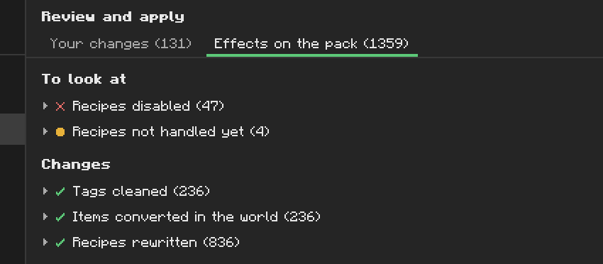

One side panel, two steps.

- **Your changes**: what you asked for, by kind (choices, process rules, items to create, data
  edits, settings). **Remove** drops a line, **Remove all** a group.

  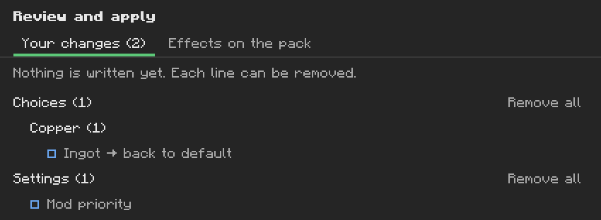

- **Effects on the pack**: what applying would do, worked out by the server: **To look at**
  (recipes disabled, recipes not handled, conflicts with your scripts), **Changes** (tags, recipes
  rewritten, items converted and created), **Undone from the current pack**. See
  [Applying Changes](Applying-Changes#what-the-review-lists).

**Apply** writes it and the game reloads its data; the screen says so and comes back when it is
done.

## Scripts

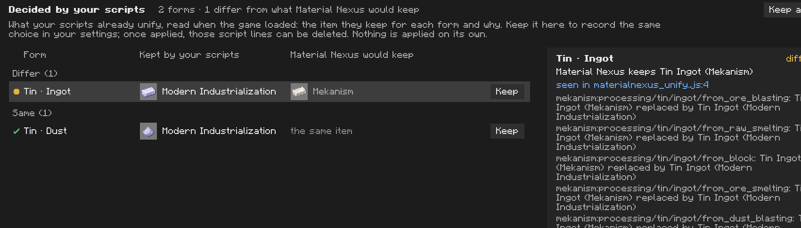

Only there when your scripts already unify something (see
[Modpacks and Multiplayer](Modpacks-and-Multiplayer#a-pack-that-already-unifies-with-scripts)). One
row per form: the item your scripts keep, the item Material Nexus keeps, and the state.
**recorded**: your settings already say the same; **same**: Material Nexus keeps it too, but only
by priority or default; **differs**: it keeps another item; **undecided**: your scripts set items
aside without keeping one. The inspector gives the evidence: the script lines naming it, the recipe
changed, the tag entry removed. **Keep this choice** makes the scripts' item a choice, **Keep all**
does it for every *same* and *differs* row.

## Rule files

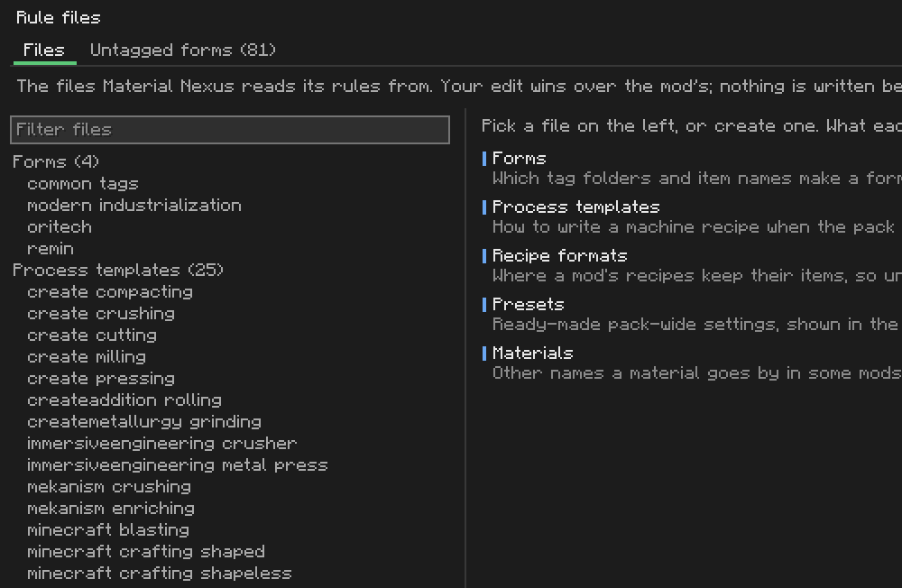

Under Advanced. The data files Material Nexus works from, editable in game. See
[Datapack Guide](Datapack-Guide#editing-in-game).

- **Files**: grouped by kind (forms, process templates, recipe formats, presets, materials), with
  what each kind does. Select one to edit its JSON; text that does not read as JSON cannot be kept,
  and the reason is written under the editor with its line. **Keep this edit** makes it a change to
  apply, **Drop pending edit** cancels, **Back to original** removes your version. **New file**
  creates one of the chosen kind.
- **Untagged forms**: item names that look like a form of a known material but are in no tag
  (`modern_industrialization:{material}_double_ingot`), with the materials they match. Type the form
  and **Declare**. Below the list:
  - **Declare tag folder**: a tag folder no form reads yet (`coils`) becomes a form (`coil`).
  - **Add to its tag**: an item id and a form (`tin/ingot`) puts that item in `c:ingots/tin`.
  - **Add missing tags** (on/off): items known as a form by their name or an alias but missing
    its tag get it, where the pack already uses that tag.

## Presets

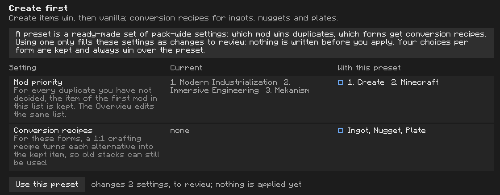

Under Advanced. Ready-made pack-wide settings, shown value by value next to yours. **Use this
preset** only fills changes to review. See [Choosing Items](Choosing-Items#presets).

## Settings, Shortcuts, Help

At the foot of the rail. **Settings** are yours only, on this computer, and change nothing in the
pack: theme (Graphite, Workshop, Paper, Midnight), font (the game's or a smooth one), density of
the lists, the technical id under item names, the folded groups open by default, reopening the
screen where you left it. **Shortcuts** lists every mouse and key shortcut; each also has a
button. **Help** opens this wiki.

## In the game

Outside the screen, item tooltips say **Material Nexus: becomes …** on an alternative and
**Material Nexus: kept item** on the kept one, once applied.
